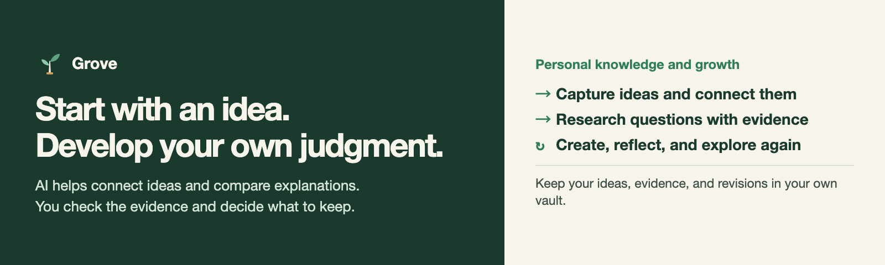

# Grove



[简体中文](README.md) · [English](README.en.md)

[](LICENSE)
[](package.json)
[](package.json)

## Turn a passing idea into knowledge you can use

Grove connects DeepSeek Harness to your Obsidian vault so you can turn a passing idea into a judgment you can explain in your own words, check against evidence, and revise in practice. Ideas, sources, reports, and drafts stay with you as Markdown, so you can return to the evidence behind a decision.

**Creating something from what you learn is how you make it your own.** Saving a report preserves someone’s explanation or your understanding at the time. Writing for someone else, explaining it aloud, or applying the method to a different question shows what you can explain and where you still need evidence. A few lines written for yourself can be enough. Putting the idea into your own words and investigating the gaps is how understanding sticks.

This process comes from the Personal Knowledge & Growth System (PKGS), which connects exploration, research, creation, and reflection. AI can help you ask follow-up questions, compare explanations, and draft. You decide whether the evidence supports the judgment. [PKGS guide](docs/PKGS.en.md)

## Why do the two sides of this street feel so different?

1. **Capture the observation.** On a walk, you notice that you linger on one side of a street and hurry through the other. Save that contrast as an idea in Grove. Next time you’re there, you can find the note with a natural-language query.
2. **Turn it into a question you can investigate.** Start research from the idea and ask whether shade, sidewalk width, or crossing wait times explain the difference. Add observations from different times, public street records, or a PDF with a text layer. Keep the sources and page references with the excerpts. Ask follow-up questions to compare explanations, then confirm a report that spells out what the evidence supports and what still needs checking.
3. **Save a judgment you can return to.** Save the confirmed report to Knowledge. Expand the entry any time to read the full report and references from the version you saved. While Grove runs, it organizes tags and related knowledge locally each day. Use the tags to filter entries or follow a related entry back to earlier research.
4. **Create something, then return to the street.** Use the knowledge entry to draft a short explanation for a neighbor and make a checklist for your next walk. If you write “shade makes this side more comfortable” and realize your observations cluster at one time of day, continue the original study and compare other times. Rewrite the explanation and try the checklist on another street to see what you’ve learned.

Notes and their versions live in the vault’s `Grove/` folder. The CLI can verify a backup and restore it to a separate directory. Features depend on the release you install. [npm package](https://www.npmjs.com/package/dsh-grove)

## Install and use

Have an Obsidian vault ready. Check [`engines` in package.json](package.json) for the supported Node.js and DeepSeek Harness versions.

- **Install from npm.** Run `dsh plugin --profile <profile> add dsh-grove`.
- **Update in Desktop.** Open **Plugins → Grove** and check again for a newer version, then follow the update prompt.
- **Try the source in Desktop.** Open **Plugins → Add plugin** and select this repository directory. Restart the host after editing the source. Desktop manages its own profile.
- **Try the source in a separate profile.** From the repository root, run the following commands.

```sh
dsh plugin --profile grove-trial add "$PWD"
dsh --profile grove-trial
```

Open **Grove** (or **知林** in Chinese) in the sidebar, choose your vault, and save an idea. Open **Research** to save a question and observations, then add sources, capture evidence, or confirm a report as needed. Grove follows the default model of the current dsh profile. Paste a public page link into the research direction to start with web evidence. In Grove **Settings**, choose an optional research model, enable Tavily for automatic discovery if desired (requires `GROVE_TAVILY_KEY`), and configure document parsing. A custom HTTPS endpoint uses `GROVE_MODEL_KEY` in the host environment.

Install the CLI separately with `npm install --global .` from the repository root, or run `npm install --global dsh-grove` for the published CLI.

```sh
export GROVE_VAULT="/absolute/path/to/Obsidian vault"
grove capture --body 'Why do the two sides of this street feel so different?'
grove list
grove show ASSET_ID --version 1
```

In a Harness session, use `grove_role` for collaboration guidance and `grove_propose` for drafts. Back in your terminal, run `grove preview DRAFT_ID`, then `grove accept DRAFT_ID` to confirm or `grove discard DRAFT_ID` to discard. To share selected assets with the model, configure the read allowlist. [Tools and permissions](docs/DETAIL.en.md)

Before upgrading, pause writes and run `grove backup /absolute/path/to/snapshot`. To restore, run `grove restore /absolute/path/to/snapshot --destination /absolute/path/to/new-vault`, check the restored files, and switch the panel to that directory. To remove the plugin, run `dsh plugin --profile <profile> remove dsh-grove`. Your vault data stays in place.

## Contributing

1. Check open issues. For a bug, include reproduction steps and the expected and actual behavior. For a feature, describe what the user needs and how to verify it. [Issues](https://github.com/kmeng/dsh-grove/issues)
2. Read the development contract and open a branch for a change reviewers can verify in one PR. Use a temporary vault and include actual test results and any gaps. [Development contract](AGENTS.en.md) · [Development guide](docs/development/README.md)
3. Run the checks below. Documentation and brand-only changes need the first two. Host checks use an installed dsh and a temporary profile.

```sh
npm ci && npm test
npm pack --dry-run --json
bash scripts/check-compat.sh
bash scripts/verify-install.sh
```

See the [journal](docs/journal/) for handoffs and release history and the [brand guide](brand/README.en.md) for logos and visual identity.
