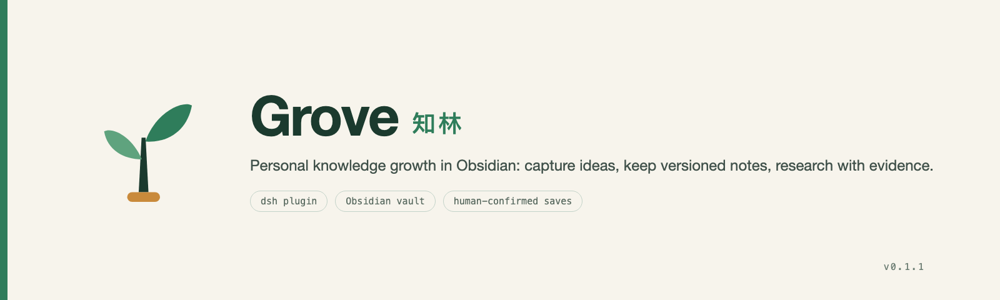

# Grove



[简体中文](README.md) · [English](README.en.md)

[](LICENSE)
[](package.json)
[](package.json)

## Personal knowledge and growth

**PKGS (Personal Knowledge & Growth System) is a method for long-term personal growth.** It connects exploration, learning, evidence-based research, creation, and reflection. Something you understood years ago may help explain a problem today. Evidence you find tomorrow may change a judgment you make today. Over time, you build knowledge you can draw on again and become better at understanding, judging, researching, and communicating.

You can practice the method with paper, Markdown, or tools you already use. The [PKGS guide](docs/PKGS.en.md) explains the design and shows how to develop questions, connect ideas, conduct research, track changes in your views, and share the work with AI.

- **Exploration** starts with an observation, uncertainty, or association. You can stop anytime or leave an open question to return to later. You decide when to research it and whether to make something from it.
- **Knowledge growth** starts by explaining an idea in your own words. Connect concepts, examples, and questions, then test your understanding through use and review.
- **Research and creation** start with a question worth investigating. Preserve sources, counterexamples, and versions of your judgment. When useful, turn what you learned into an article, report, or proposal. Reflection can give you a starting point for the next exploration.

AI can ask questions, compare explanations, surface counterexamples, and help you express an idea. You decide what to believe, keep, and share.

## How Grove puts the method into practice

Grove connects DeepSeek Harness and Obsidian. The current version connects open-ended conversation, user-confirmed saves, and basic evidence tracking. Choose what to keep from a conversation, save it as Markdown in your own vault, and use versions and wikilinks to revisit relationships among questions, evidence, and claims. You can practice the guide’s learning, reflection, and full research methods by hand.

## Install v0.1.1

You need Node.js 22 or later, an existing Obsidian vault, and DeepSeek Harness `>=0.2.2-rc.1 <0.3.0`. The `engines.dsh` range determines whether the host loads the bundle.

### Install in an existing Harness

| Entry point | Steps |
| --- | --- |
| Desktop | Open **Plugins → Add plugin** and select this repository directory. The host installs a `link:` dependency. Restart the host after editing the source. |
| In a session | Ask the agent to call `plugin_manager` with `install_bundle` and pass the directory’s absolute path as `target`. |
| CLI | Run `dsh plugin --profile <profile> add <directory-or-tgz>`. The Desktop app manages its own profile. Packages installed into `profiles/web` do not appear there. |

Check that Grove appears on the **Plugins** page, then ask the model to call `grove_role` in a new session to confirm the tool is registered.

### Try a separate profile

```sh
export GROVE_VAULT="/absolute/path/to/Obsidian vault"
npx --yes @deepseek-ai/dsh@0.2.2-rc.3 plugin --profile grove add "$PWD"
npx --yes @deepseek-ai/dsh@0.2.2-rc.3 --profile grove
```

Initialize a separate profile once. If the `grove` profile already exists, install or launch directly. In your trial profile, keep host shell access, file editing, general automation, and other extensions from accessing the vault or running confirmation commands on your behalf. Grove’s model tools provide role guidance, drafts, and allowlisted reads. Harness sessions also follow the host’s routing, permissions, and history settings.

### Install the command-line tool

A global installation puts the package’s `grove` executable on PATH. Installing the plugin in a profile registers it with the host.

```sh
npm pack --pack-destination /tmp
npm install --global /tmp/dsh-grove-0.1.1.tgz
```

## Everyday use

1. Run `grove capture --body 'Why might coordination costs increase as an organization grows?'` and open the `Grove` folder in Obsidian to see the Markdown note.
2. Explore in Harness. Use `grove_role` for a thinking partner, knowledge assistant, research assistant, critical reviewer, or creation assistant. Ask `grove_propose` to draft a note when you want to keep something, and supply the conversation reference you want to save. You can also end the exploration there.
3. Run `grove preview DRAFT_ID` in your terminal. Use `grove accept DRAFT_ID` and type `SAVE`, or run `grove discard DRAFT_ID`. Pass `--file` when accepting to supply your edited body.
4. Use `grove list` and `grove show ASSET_ID --version 1` to revisit your notes. To share selected notes with the model, set `GROVE_READABLE_IDS` to a comma-separated list of asset IDs before starting the host. Restart the host after revoking that access. Content already shared in a session follows the host’s history settings.

## Basic research

```sh
grove add question --body 'How does team size affect decision speed?'
grove add research --question QUESTION_ID --body 'Compare decision authority and coordination costs'
grove add evidence --body 'Add a checkable excerpt' --source 'https://example.org/report' --locator 'Page 12, paragraph 2'
grove add claim --body 'My current judgment'
grove update CLAIM_ID --version 1 --link EVIDENCE_ID --relation supports
grove update RESEARCH_ID --version 1 --link CLAIM_ID --relation related
grove update RESEARCH_ID --version 2 --stage analysis
grove update RESEARCH_ID --version 3 --stage review --status closed
```

Use the IDs returned by the earlier commands. You can revisit stages and pause, reopen, or archive questions and projects. Evidence can support, refute, or qualify a claim. Links target specific versions. When you rewrite a claim, its earlier evidence links stay on the earlier version. You can explicitly adopt evidence again for the new version. A research project can close with or without a deliverable.

## Data and removal

Version files in `Grove/` use YAML properties, Markdown bodies, and Obsidian wikilinks. Grove reads within its own folder. Copy the whole folder, including hidden drafts, to back it up or move it. You can read and edit bodies in Obsidian while preserving file names and Grove metadata. Use `grove update` to retain the earlier version. The current version records source identifiers and locations you supply. See the [plugin details](docs/DETAIL.en.md) for current limits.

To remove the host plugin, run `npx --yes @deepseek-ai/dsh@0.2.2-rc.3 plugin --profile grove remove dsh-grove`. Your vault data stays in place. Remove the command separately with `npm uninstall --global dsh-grove`.

## Brand assets

See the [brand assets](brand/README.en.md) and the visual identity guide ([English](brand/VI.en.md) · [简体中文](brand/VI.md)). Tests check that the package’s `icon.svg` matches `brand/mark.svg` byte for byte.

## Contributing

Read the [development contract](AGENTS.en.md) ([简体中文](AGENTS.md)). The Claude Code, Cursor, and Copilot instructions point to the same contract. See the [development guide](docs/development/README.md) for issue structure, acceptance, and review rules, and the [journal](docs/journal/) for handoffs. Before making changes, run the tests and `bash scripts/check-compat.sh`.

## Verify from source

```sh
npm ci
npm test
npm pack
```
