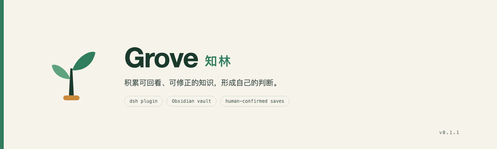

# Grove（知林）



[简体中文](README.md) · [English](README.en.md) · [MIT 许可](LICENSE)

## 缘起

知林源于一个问题：怎样让一次对话、一条灵感或一轮研究，成为以后还能找回、核对和修正的知识？Grove 把 DeepSeek Harness 与你自己的 Obsidian vault 连起来，让这些内容以 Markdown 留在手边。

背后的 PKGS（Personal Knowledge & Growth System）把思想探索、学习、研究、创作和反思连在一起。你可以只记一句话，也可以在实践后修正自己的判断，把更新后的理解带进下一轮研究。AI 可以帮你比较解释、追问和起草，你决定相信什么、留下什么以及分享什么。 [PKGS 方法指南](docs/PKGS.zh.md)

## 核心功能

以下功能以本仓库源码为准。通过 npm 安装时，以注册表已发布的版本为准。 [npm 包](https://www.npmjs.com/package/dsh-grove)

- **叮一下**。记下一句灵感，之后按关键词找回，也能打开历史版本。
- **研究与证据**。直接发起独立研究，或配置模型分析选定的摘录。导入 Markdown 和有文本层的 PDF，给摘录留下段落或页码，核对后保存报告。
- **知识与作品**。从报告提炼概念或方法，用已有知识起草作品。修订知识时记录原因，旧作品仍可回查当时使用的版本。
- **本地数据**。笔记和历史版本保存在 vault 的 `Grove/` 目录。CLI 可创建校验过的备份并恢复到独立目录。

## 安装与使用

准备一个 Obsidian vault。Node.js 与 DeepSeek Harness 的兼容要求见 [package.json 的 `engines`](package.json)。

- **从 npm 安装**。运行 `dsh plugin --profile <profile> add dsh-grove`。
- **在 Desktop 试用源码**。在 **Plugins → Add plugin** 选择本仓库目录。修改源码后重启宿主。Desktop 使用自己管理的 profile。
- **用独立 profile 试用源码**。在仓库根目录执行以下命令。

```sh
dsh plugin --profile grove-trial add "$PWD"
dsh --profile grove-trial
```

装好后，从左侧打开中文界面的 **知林** 或英文界面的 **Grove**，选择 vault，写下一句并点「💡叮～」。想研究一个问题时，打开「研究」，保存问题和观察，再按需上传资料、保存摘录与确认报告。使用「AI 深挖」前，在研究面板填写兼容 Chat Completions 的 HTTPS 接口和模型名称，并在宿主环境设置 `GROVE_MODEL_KEY`。

也可以单独安装终端命令。在仓库根目录执行 `npm install --global .` 可安装源码中的 CLI。执行 `npm install --global dsh-grove` 可安装 npm 已发布的 CLI。

```sh
export GROVE_VAULT="/absolute/path/to/Obsidian vault"
grove capture --body '同一条街，为什么两边走起来差这么多？'
grove list
grove show ASSET_ID --version 1
```

在 Harness 会话中，可用 `grove_role` 选协作角色，用 `grove_propose` 起草。回到终端用 `grove preview DRAFT_ID` 查看，再用 `grove accept DRAFT_ID` 确认或用 `grove discard DRAFT_ID` 丢弃。向模型开放指定资产时，按插件详情配置读取白名单。 [工具与权限说明](docs/DETAIL.zh.md)

升级前暂停对库的写入，用 `grove backup /absolute/path/to/snapshot` 校验备份。需要恢复时运行 `grove restore /absolute/path/to/snapshot --destination /absolute/path/to/new-vault`，检查后在面板切换到恢复目录。卸载可用 `dsh plugin --profile <profile> remove dsh-grove`，vault 数据保留。

## 贡献代码

1. 先看开放 issue。修 bug 时写清复现步骤、预期结果和实际结果。提功能时说明用户场景和可验证的验收条件。 [Issues](https://github.com/kmeng/dsh-grove/issues)
2. 阅读开发契约，从分支提交一个可独立验收的 PR。用临时 vault 验证，附上实际测试结果和未覆盖的情况。 [开发契约](AGENTS.md) · [开发指南](docs/development/README.md)
3. 本地运行下列检查。只改文档或品牌素材时跑前两项。宿主验证用已安装的 dsh 和临时 profile。

```sh
npm ci && npm test
npm pack --dry-run --json
bash scripts/check-compat.sh
bash scripts/verify-install.sh
```

项目交接与发布记录见 [journal](docs/journal/)。标志和视觉规范见 [品牌资产](brand/README.md)。
