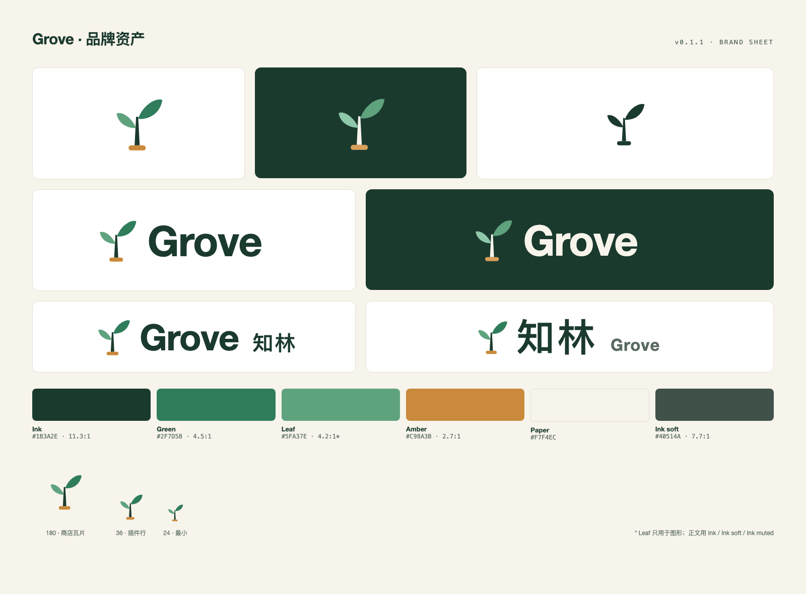

# Brand assets



## Files

| Path | Size | Use |
| --- | --- | --- |
| `mark.svg` | 36 viewBox | Light-background mark (identical to root `icon.svg`) |
| `mark-on-dark.svg` | 36 viewBox | Dark-background mark |
| `mark-mono.svg` | 36 viewBox | Single ink |
| `logo-light.svg` | 132×40 | Light-background lockup |
| `logo-dark.svg` | 132×40 | Dark-background lockup |
| `logo-zh.svg` | 152×40 | English wordmark with 知林 |
| `logo-zh-primary.svg` | 158×40 | Chinese-first lockup |
| `tokens.css` / `tokens.json` | — | Color, type, spacing, radii |
| `exports/icon-180.png` | 180×180 PNG | Plugin-market tile (transparent) |
| `exports/icon-180-tile.png` | 180×180 PNG | Market tile on Paper |
| `exports/icon-512.png`, `icon-1024.png` | square PNG | Avatars, store images |
| `exports/logo-*.png` | PNG | Documents, slides |
| `exports/social-preview-1280x640.{en,zh}.png` | 1280×640 | GitHub social preview |
| `exports/readme-header-1600x480.{en,zh}.png` | 1600×480 | README header |
| `exports/overview.png` | 1600×1180 | Everything on one sheet |

Spec: [`VI.en.md`](VI.en.md) (English) · [`VI.md`](VI.md) (中文).

## Regenerate

```sh
cd brand/src && ./build.sh
```

Requires Google Chrome (the script renders with headless screenshots; override with `CHROME=/path/to/chrome`). `brand/src/*.html` holds the layout sources.

`brand/` is not shipped in the npm package: the plugin row reads the root `icon.svg`, and the market tile is served from GitHub raw.
