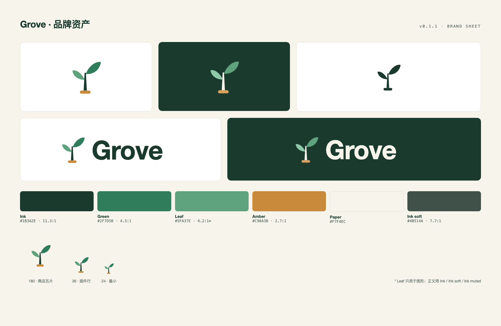

# 品牌资产



## 文件

| 路径 | 规格 | 用途 |
| --- | --- | --- |
| `mark.svg` | 36 视框 | 浅底标志（与根目录 `icon.svg` 一致） |
| `mark-on-dark.svg` | 36 视框 | 深底标志 |
| `mark-mono.svg` | 36 视框 | 单色 |
| `logo-light.svg` | 132×40 | 浅底锁定组合 |
| `logo-dark.svg` | 132×40 | 深底锁定组合 |
| `logo-zh.svg` | 152×40 | 中英并置 |
| `tokens.css` / `tokens.json` | — | 颜色、字体、间距、圆角 |
| `exports/icon-180.png` | 180×180 PNG | 插件市场瓦片（透明） |
| `exports/icon-180-tile.png` | 180×180 PNG | 市场瓦片（纸白底，通用性更好） |
| `exports/icon-512.png` / `icon-1024.png` | 方形 PNG | 头像、商店大图 |
| `exports/logo-light.png` / `logo-dark.png` | 528×160 PNG | 文档、PPT |
| `exports/social-preview-1280x640.png` | 1280×640 | GitHub 社交预览 |
| `exports/readme-header-1600x480.png` | 1600×480 | README 头图 |
| `exports/overview.png` | 1600×1040 | 一页看全 |

规范见 [`VI.md`](VI.md)。

## 重新生成

```sh
cd brand/src && ./build.sh
```

需要本机安装 Google Chrome（脚本用 headless 截图渲染；`CHROME=/path/to/chrome` 可覆盖）。`brand/src/*.html` 是版式源文件，改文案或排版后重跑即可。

`brand/` 不进入 npm 包：插件行只读根目录的 `icon.svg`，市场瓦片由 GitHub raw 提供。
