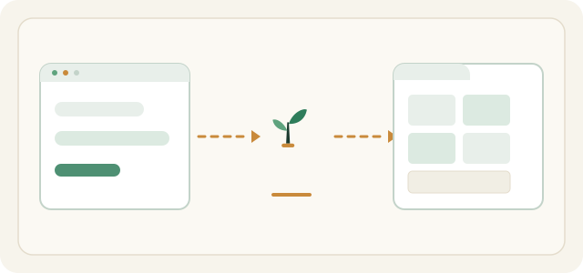

Open Grove from the left sidebar, connect your own Obsidian vault, and keep what you explore as Markdown notes you can revisit and revise.

On Home, capture ideas or ask to find an idea, report, or knowledge note. Start research from an idea and keep follow-up questions and their reports in one conversation. Confirm a report, then save its findings to Knowledge with one click and revisit the source report whenever needed.
