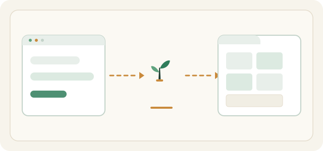

安装后从左侧菜单的 Grove 打开面板，连接自己的 Obsidian vault，把探索留下的笔记保存在可回看、可修订的 Markdown 里。

首页用「叮」保存灵感，也可以用一句话查找灵感、报告或知识。打开一条灵感即可发起研究，后续追问和报告留在同一场研究里。确认报告后，点「提炼为知识」即可保存结论与来源，在知识库展开条目即可读到当时保存的完整报告，也可点「继续研究」回到原课题。知林在运行时每天从 vault 本地整理一次标签与相关知识，标签可用于筛选条目。

在「作品」新建文章，也可以从知识或报告点「写成作品」。左侧讨论并确认主题、提纲和各节候选稿，右侧只显示文章预览。可以为当前小节补充材料，确认后的正文和引用仍可追溯。配图支持上传、由数据渲染图表、调用配置好的图片模型或取得提示词。保存成稿后可将该版本收录到知识库，退出后也可以从作品列表恢复草稿。 从本节发起研究后，可用「确认报告并带回小节」把报告的确切版本加入本节素材。正文与提纲仍由你确认修改。

作品写作模型可跟随宿主默认模型，也可独立选用宿主模型。自定义写作 HTTPS 接口使用 `GROVE_WORK_MODEL_KEY`。图片模型可选，填写完整的 HTTPS 图片生成端点与模型名。端点须返回 `data[0].b64_json`，宿主使用 `GROVE_IMAGE_MODEL_KEY`。
